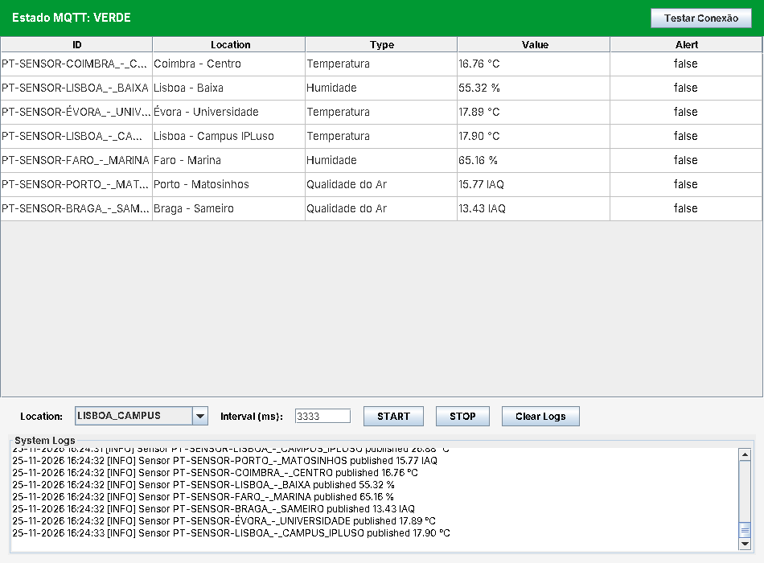

# MonitorizaPT — simulated environmental monitoring (Java · Swing · MQTT)

Desktop application that simulates seven environmental sensors (temperature, humidity and air quality) in different Portuguese locations, shows their readings in a Swing interface, flags alerts and publishes every reading as JSON over MQTT. Each sensor can also be controlled remotely through MQTT commands.

Individual academic project by **Pedro Caldeira** for the *Object-Oriented Programming* course of the CTeSP in Web and Mobile Development at IPLUSO — Instituto Politécnico da Lusofonia (Lisbon).



*Screenshot taken from this repository's code, running against a local MQTT broker.*

## What it does

- Creates seven **simulated** sensors (no physical hardware):

  | Location | Type | Unit |
  |---|---|---|
  | Lisboa - Campus IPLuso | Temperature | °C |
  | Lisboa - Baixa | Humidity | % |
  | Porto - Matosinhos | Air quality | IAQ |
  | Coimbra - Centro | Temperature | °C |
  | Faro - Marina | Humidity | % |
  | Braga - Sameiro | Air quality | IAQ |
  | Évora - Universidade | Temperature | °C |

- Each sensor runs in its own thread and, while active, generates a reading every 3333 ms by default.
- Readings outside the expected range are flagged as alerts (temperature above 30 °C, humidity above 80 %, air-quality index above 50). The temperature sensors also occasionally produce an implausible value (−45 °C) on purpose, to exercise alert handling.
- Every reading is published as JSON to `envira/pt/sensores/dados/<Location>` and shown in the table and log of the Swing window.
- Each sensor subscribes to `envira/pt/sensores/comandos/<Location>` and accepts commands to activate/deactivate it and to change its interval.
- Each JSON payload includes a `hash_validacao` field: a SHA-256 hash of the payload (without that field and without spaces), so a receiver can check that the message content matches. It is an integrity check, not encryption.

## Design

| Package | Responsibility |
|---|---|
| `domain` | `Sensor` interface, `SensorAbstrato` abstract base class (thread loop, commands, publishing), sensor types and locations |
| `sensors` | `SensorTemperatura`, `SensorHumidade`, `SensorQualidadeAr` — type-specific data generation |
| `service` | `SensorFactory` — creates the sensors, starts their threads, routes remote commands and notifies observers |
| `mqtt` | `MqttClientManager` — wraps the Eclipse Paho client (async connect, automatic reconnect, subscriptions) |
| `ui` | `MonitorizaPTFrame` and `SensorTableModel` — Swing window, table, controls and log |
| `util` | `JsonPayloadBuilder` — JSON payload (Gson) and SHA-256 field |
| `app` | `MonitorizaPTApplication` — entry point |

The UI receives updates through listeners (`SensorUpdateListener` / observers registered in `SensorFactory`), so the sensor threads do not depend on Swing classes.

## Requirements

- Java 17+
- Maven 3.6+
- An MQTT broker. For local testing, [Eclipse Mosquitto](https://mosquitto.org/) on `localhost:1883` works.

## Build and run

```bash
mvn compile
mvn exec:java
```

By default the application connects to `tcp://localhost:1883`. To use another broker:

```bash
mvn exec:java -Dmonitorizapt.broker=tcp://broker.example.org:1883
# or
MONITORIZAPT_BROKER=tcp://broker.example.org:1883 mvn exec:java
```

Sensors start **inactive**. Activate them from the window (choose a location, set the interval and press **START**) or through MQTT commands.

## MQTT messages

Topic names are built from the location name with spaces replaced by underscores, e.g. `Lisboa_-_Campus_IPLuso`.

**Published reading** — `envira/pt/sensores/dados/Lisboa_-_Campus_IPLuso` (real message captured during testing):

```json
{
  "campus": "IP Lisboa",
  "sensor": "PT-SENSOR-LISBOA_-_CAMPUS_IPLUSO",
  "ID Unico": 496938147,
  "Owner": "Pedro_Caldeira",
  "tipo": "Temperatura",
  "valor": 17.14,
  "unidade": "°C",
  "alerta": false,
  "timestamp": 1795623862829,
  "hash_validacao": "502ffe1640aa87415623a5d38d8f906ffb158c7021bc28959b771a8932e2633f"
}
```

**Command** — `envira/pt/sensores/comandos/<Location>`:

```json
{ "acao": "ATIVAR", "intervalo": 3333 }
```

`acao` accepts `ATIVAR` or `DESATIVAR`; `intervalo` (optional) is in milliseconds and must be at least 1000.

Example with the Mosquitto command-line tools:

```bash
mosquitto_sub -h localhost -t 'envira/pt/sensores/dados/#' -v
mosquitto_pub -h localhost -t 'envira/pt/sensores/comandos/Lisboa_-_Campus_IPLuso' -m '{"acao":"ATIVAR","intervalo":1500}'
mosquitto_pub -h localhost -t 'envira/pt/sensores/comandos/Lisboa_-_Campus_IPLuso' -m '{"acao":"DESATIVAR"}'
```

## Verification

Checked with Java 17 and Maven against a local MQTT broker:

- the project compiles with `mvn compile`;
- after `ATIVAR` commands, all seven sensors published to their data topics;
- an `intervalo` of 1500 ms roughly doubled the publishing rate of that sensor, and `DESATIVAR` stopped it;
- the `hash_validacao` value of every captured message matched a SHA-256 recomputed from the payload.

There are no automated unit tests in this project.

## Changes from the submitted version

Small changes were made for publication only; the application logic is unchanged:

- the broker address, previously fixed to the school's broker, is now configurable and defaults to `localhost`;
- the `Owner` field no longer contains the student number (it is configurable with `-Dmonitorizapt.owner=...`);
- `exec-maven-plugin` was added to `pom.xml` so the application starts with `mvn exec:java`;
- build output, IDE settings and an older copy of the sources were not included.

## Limitations

- Readings are random values within fixed ranges; there is no persistence or history beyond the on-screen log.
- MQTT uses QoS 0 without authentication or TLS.
- The interface mixes Portuguese and English labels.
